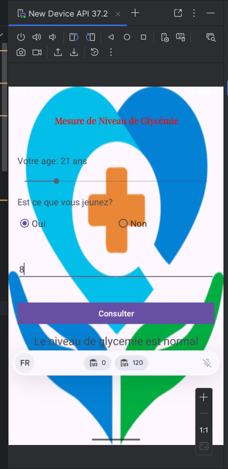

# Mesure de glycémie

Application Android permettant de saisir son âge, d’indiquer si l’on est à jeun et de consulter une interprétation indicative d’une valeur de glycémie en mmol/L.

## Fonctionnalités

- Sélection de l’âge avec une barre de progression (de 0 à 120 ans).
- Choix de l’état de jeûne : oui ou non.
- Saisie de la valeur mesurée en mmol/L.
- Affichage d’un message indiquant si la valeur est basse, normale ou élevée selon les seuils configurés dans l’application.

## Technologies

- Android
- Java
- Interface conçue en XML

## Utilisation

1. Ouvrir l’application.
2. Choisir l’âge avec le curseur.
3. Indiquer si la mesure a été réalisée à jeun.
4. Saisir la valeur mesurée en mmol/L.
5. Appuyer sur **Consulter** pour afficher le résultat.

## Capture du résultat

Ajouter ici une capture d’écran de l’application après avoir appuyé sur **Consulter** :

Pour afficher la capture dans ce README, placer le fichier image à l’emplacement `docs/capture-resultat.png`. Vous pouvez remplacer ce chemin par celui de votre propre capture.

## Remarque

Le résultat affiché est une indication basée sur les seuils programmés dans l’application. Il ne remplace pas l’avis d’un professionnel de santé.
